# 🐚 Shellix (`sx`)

> **A blazing-fast, developer-first terminal workbench built in pure Go.**  
> Single static binary. Cross-platform. Secure. Built-in automation flows, instant Git engine, and multi-repo search.

---

## ⚡ Why Shellix?

Traditional terminals and toolchains on Windows and cross-platform environments suffer from high fork latencies and fractured tooling:
- **Git Bash on Windows** relies on MSYS2 POSIX emulation layers, introducing 200–500ms overhead on process calls.
- **Context-Switching Tax**: Developers constantly juggle separate tools for terminal emulation, Git GUIs, SSH clients, search tools, and deployment scripts.

**Shellix solves this by combining these capabilities into a single native binary (under 15MB) with zero external runtime dependencies (no Electron, no Node.js, no Python).**

```
┌─────────────────────────────────────────────────────────────────┐
│                       Shellix Workbench                         │
├─────────────────┬──────────────────┬────────────────────────────┤
│ Dual-Engine Git │ Automation Flows │ Cross-Repo Search Engine   │
│ In-process Go   │ YAML-defined     │ Parallel goroutine search  │
│ (< 2ms status)  │ tasks & pipelines│ across multiple codebases  │
├─────────────────┼──────────────────┼────────────────────────────┤
│ SSH Multiplexer │ TUI Interface    │ Developer Shortcuts        │
│ Crypto/SSH with │ Elm-architecture │ Snippets, bookmarks, and   │
│ connection pool │ Bubble Tea views │ smart history              │
└─────────────────┴──────────────────┴────────────────────────────┘
```

---

## 📸 Screenshots & UI Walkthrough

### 1. Interactive Git Dashboard (`sx g`)
Full-screen, keyboard-driven dashboard to stage (`s`), unstage (`u`), commit (`c`), and view live syntax-highlighted diffs:
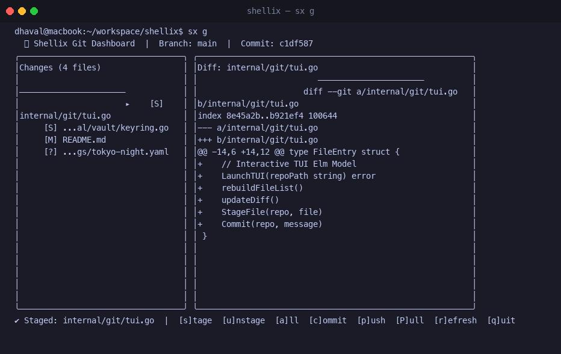

### 2. Instant Status & Banner
Sub-2ms Git inspection directly from disk:
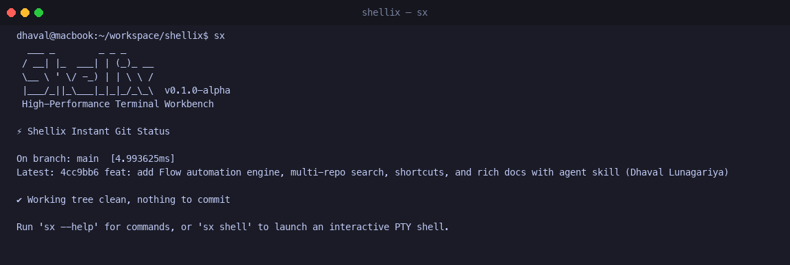

### 2. Flow Automation Engine
Run declarative pipelines with parallel step execution and audit logging:
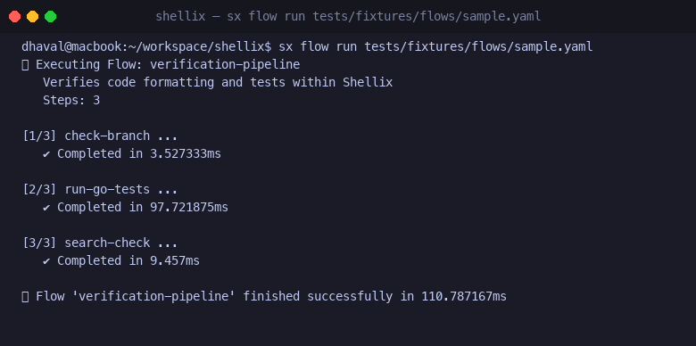

### 3. Parallel Java & Multi-Module Builds
Run Java and Go builds concurrently in a single flow:
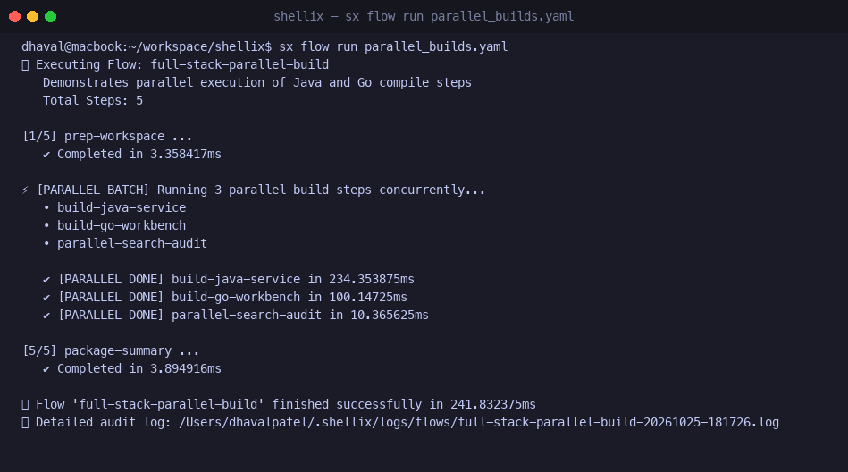

### 4. Java Multi-Version Discovery & Switching
Discover all installed JDKs (Adoptium, Corretto, Temurin, Homebrew) and switch seamlessly:
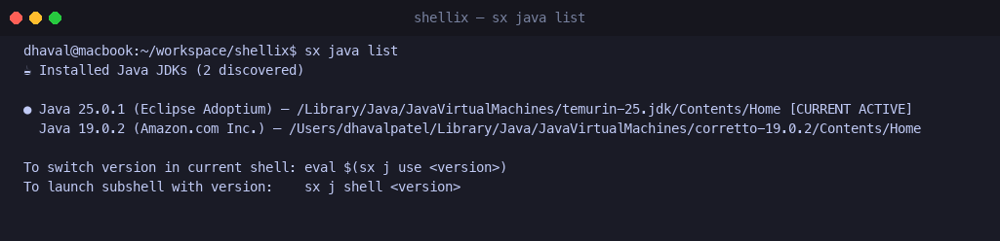

### 5. Native OS Credential Manager (Vault)
Zero-leak secrets backed by Windows Credential Manager and macOS Keychain:
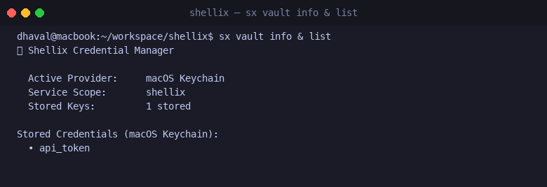

### 6. Multi-Repo Parallel Search
Search across multiple codebases with syntax-highlighted matching lines:
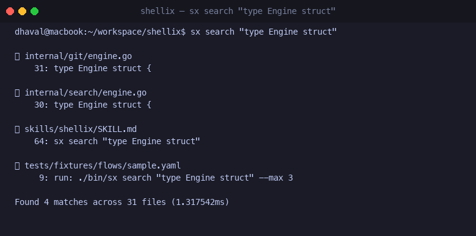

### 6. SSH Multi-Server Target Management
Manage server targets and execute commands in parallel across Linux nodes:
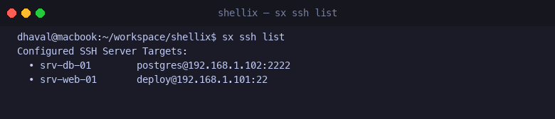

### 7. GitHub & GitHub Enterprise Integration (HTTPS + PAT)
Manage PRs, Issues, and CI runs directly from your terminal across public GitHub and GitHub Enterprise Server:
```bash
sx github auth            # Save PAT for github.com into OS Keyring
sx github auth <token> --host github.corp.internal # Save PAT for Enterprise Server
sx github whoami          # Verify authenticated profile (auto-detects host from repo)
sx pr list                # List open pull requests
sx pr view 42             # View PR details
sx pr create --title "..." # Open new pull request
sx issue list             # List open issues
sx issue view 10          # View issue details
sx issue create --title "..." # Create new issue
sx ci                     # Check CI workflow runs for current branch
```

### 8. System Doctor & Diagnostics
Run deep environment health checks on Git, JDKs, Keyring, and SSH hardening:
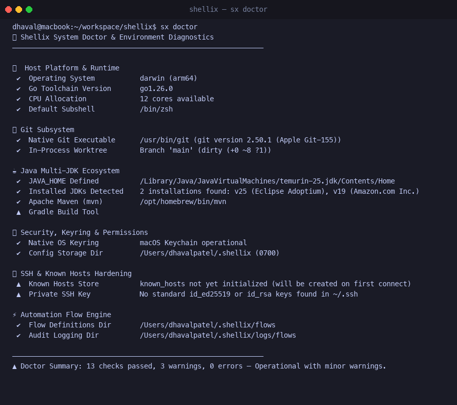

### 9. SSH Port Forwarding Tunneling
Encrypted local port forwarding over SSH without third-party tools:
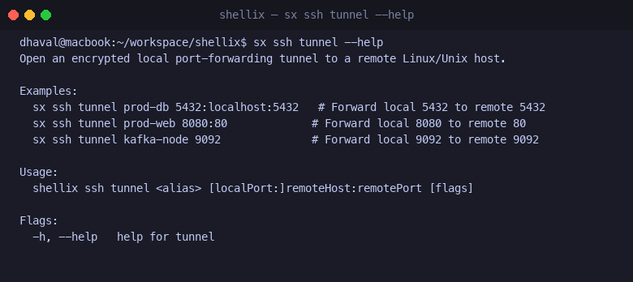

### 10. Rapid Developer Onboarding (`sx init`)
Initialize ~/.shellix storage, secure permissions, and instant shell aliases:
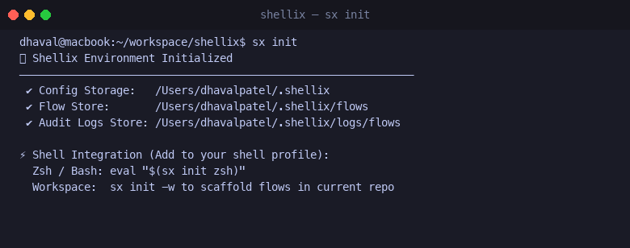

### 11. Developer Shortcuts
Manage directory bookmarks and reusable command snippets:
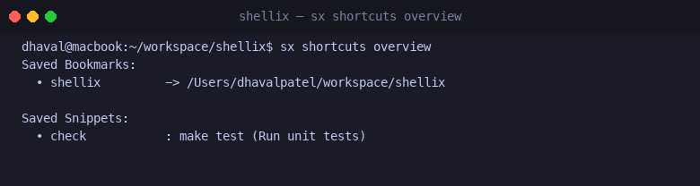

### 12. Interactive Flow TUI (`sx flow run --tui`)
Full-screen Bubble Tea dashboard with real-time spinners, live log streaming, and step progress:


### 13. Command History & Execution Analytics (`sx history`)
In-memory searchable command history with deduplication, latency metrics, and success rates:
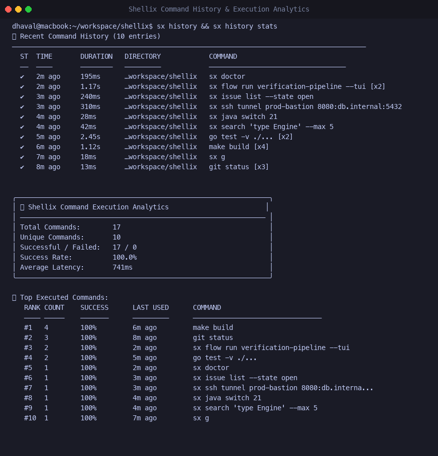

### 14. Interactive GitHub Workbench (`sx gh`)
Multi-tab TUI for Pull Requests, Issues, and CI checks across public and Enterprise GitHub:


### 15. Universal Command Palette (`sx palette`)
Fuzzy command launcher connecting flows, Java runtimes, SSH profiles, bookmarks, and history:


### 16. Flow Automated File Watcher (`sx flow watch`)
Continuous test-driven development loop that auto-runs pipelines upon file modifications:
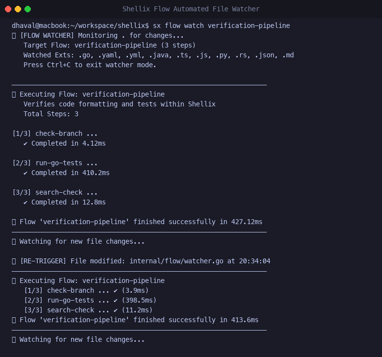

### 17. Interactive Git Branch Switcher (`sx branch`)
Fuzzy branch selector with ahead/behind status, commit summaries, and instant checkout:


### 18. Live Workflow Recorder (`sx flow record`)
Interactively record shell commands and automatically synthesize declarative YAML workflows:
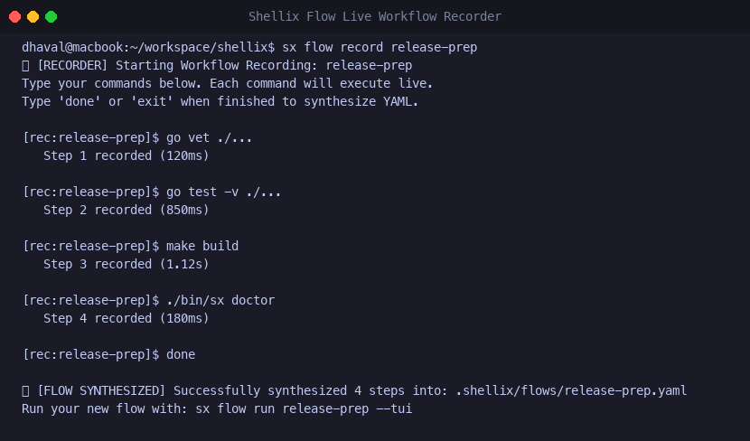

### 19. HTTP & API Terminal Client (`sx http` / `sx api`)
High-precision HTTP client with sub-millisecond network timing metrics (DNS, TCP, TLS, TTFB), automatic JSON detection, and side-by-side API endpoint diffing:
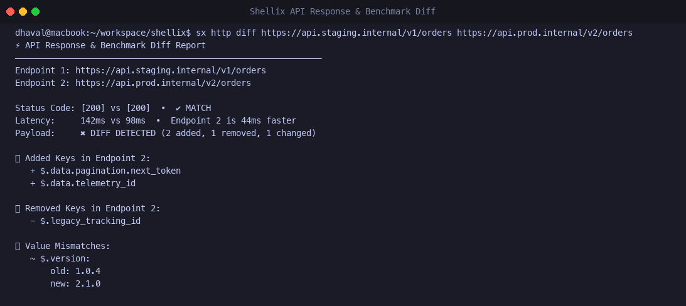

### 20. Project Environment & Secret Injection (`sx env` / `.env.vault`)
Hardware-backed AES-256-GCM encrypted local environment store with automatic key management via OS Credential Vault (Windows Credential Manager / macOS Keychain) and secret-masked child process execution:
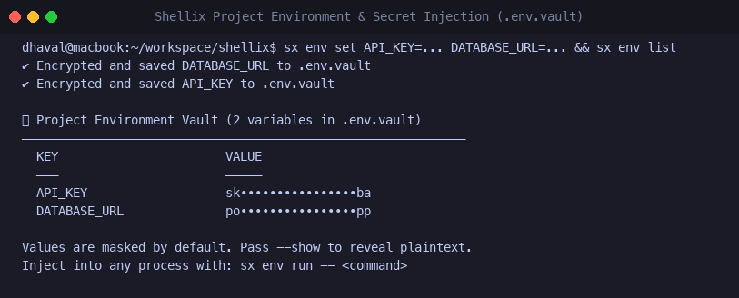

### 21. Flow Cron & Recurring Scheduler (`sx flow schedule`)
Standard 5-field cron automation scheduler with macros (`@hourly`, `@daily`, `@weekly`), next trigger calculations, state tracking, and background daemon runner:
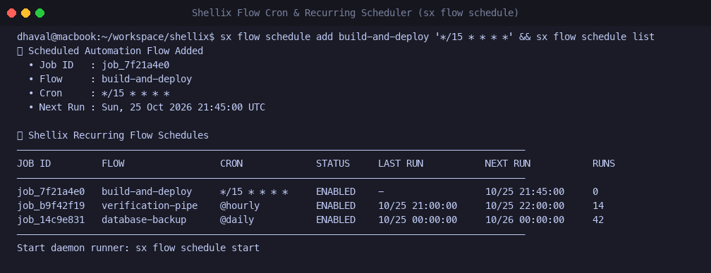

### 22. Streaming Large File & JSON Diff Engine (`sx json` / `sx view`)
High-throughput streaming viewer for multi-gigabyte logs (with chunked reverse tail seek) and JSONPath querying (`.data.items[0]`) with deep schema structural diffing:
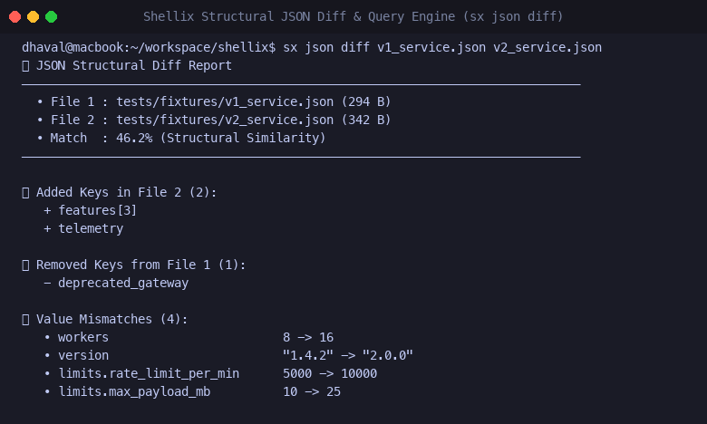

### 23. Windows PowerShell Dynamic Auto-Completion & Auto-Hook (`sx completion` & `sx env hook`)
First-class Windows developer experience: dynamic tab completion across flows, secret keys, git branches, and saved SSH hosts, paired with `direnv`-style auto-loading prompt hooks:
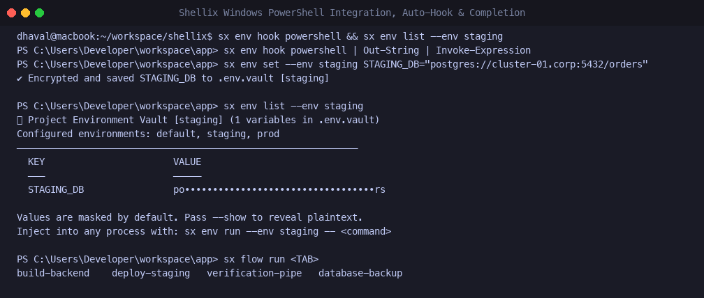

### 24. Interactive Collapsible JSON Tree Explorer (`sx json tui`) & API Assertions
Interactive keyboard-driven tree browser for nested payloads with real-time fuzzy filtering (`/`), expand/collapse (`Enter`/`e`/`c`), and automated API health check assertions (`--assert-status`, `--assert-json`):
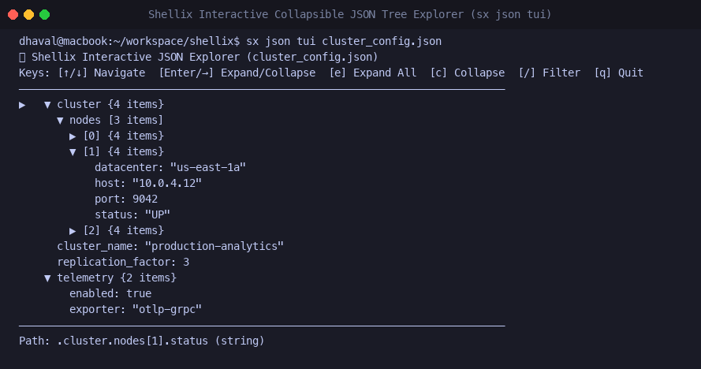

### 25. Workflow Execution Blueprint, Approval Gates & Artifact Preservation (`sx flow plan` & `sx flow artifacts`)
Preview DAG execution waves, parameter overrides (`--set key=val`), and step dependencies without running side effects. Export Mermaid flowcharts (`--mermaid`), guard production deployments with interactive approval gates (`prompt:`), preserve build artifacts in `~/.shellix/artifacts/`, and receive native desktop alerts (`notify:`) on Windows BalloonTip/Toast and macOS:
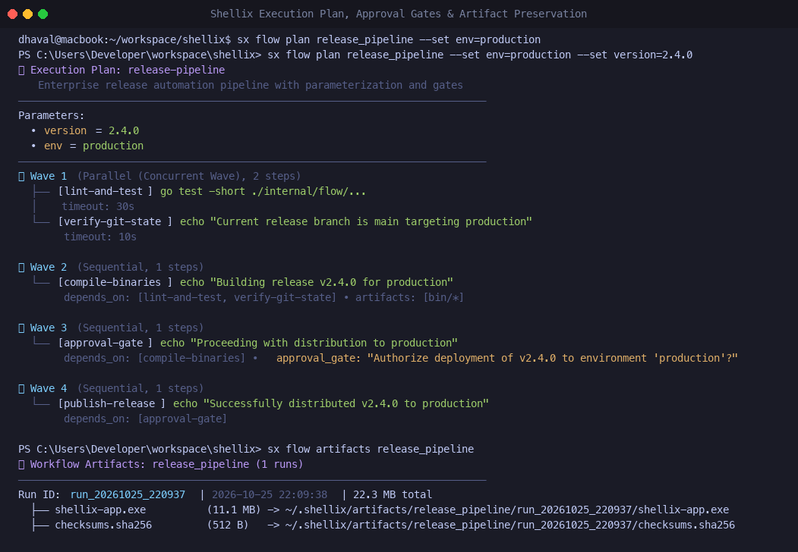

---

## 🚀 Key Features

1. **Dual-Engine Git Layer**:
   - **Fast Path (`go-git`)**: In-process status, branch tracking, and commit inspection running in **~1.5ms to 2.5ms** with zero fork or emulation delay.
   - **Full Path (Native Git)**: Seamless and transparent passthrough to the system Git binary for complex rebase, merge, and stash workflows.
2. **Shellix Flows (Automation Engine)**:
   - Declarative YAML workflows to automate builds, tests, releases, and local pipelines (pure local Go compiler, Java Maven/Gradle, Git, and test runners—zero Docker required).
   - Support for sequential and parallel execution waves, dependency DAGs (`depends_on`), conditional step execution (`if:`), timeouts with exponential backoff, parameterization (`params` & `--set`), interactive approval gates (`prompt:`), artifact preservation (`artifacts:` & `sx flow artifacts`), dry-run execution blueprinting (`sx flow plan`), Mermaid architecture exports (`--mermaid`), and desktop/webhook notifications (`notify:`).
3. **Multi-Repo Intelligent Search**:
   - High-throughput parallel file tree walking and regex/literal searching across dozens of registered repositories simultaneously.
4. **Developer Productivity Shortcuts**:
   - Path bookmarking (`sx bm`) and command snippet management (`sx snip`).
5. **Interactive TUI**:
   - Powered by Charmbracelet's Bubble Tea and Lip Gloss.
6. **Agent-Friendly & Richly Documented**:
   - Native AI Agent skills and specifications inside the repository so coding agents can seamlessly interact with Shellix workflows.

---

## 📦 Installation & Quick Start

### Build from Source

Requirements: Go 1.24+

```bash
# Clone or navigate to the workspace
cd /Users/dhavalpatel/workspace/shellix

# Build the static binary
make build

# The binary is placed in bin/shellix with a symlink to bin/sx
./bin/sx version
```

### Quick Commands

```bash
# 1. Instant Status (Sub-2ms Git inspection)
sx g s

# 2. Transparent Git passthrough
sx g log -n 5 --oneline

# 3. Interactive Shell
sx shell

# 4. Automation Flows
sx flow run deploy-staging.yaml
sx flow list

# 5. Multi-Repo Search
sx search "func HandleAuth"

# 6. Bookmarks & Snippets
sx bm add myproject .
sx bm list
sx snip add test "go test -v ./..."
sx snip run test

# 7. HTTP & API Diffing and Automated Health Assertions
sx http get https://api.github.com/zen --assert-status 200
sx http get https://api.prod.corp/health --assert-json ".status=healthy" --assert-max-latency 500ms
sx http diff https://api.staging.corp/health https://api.prod.corp/health

# 8. Project Environment Vault & Scoped Secret Injection
sx env set --env staging API_KEY=sk_live_9381 DATABASE_URL=postgres://...
sx env list --env staging
sx env run --env staging -- ./deploy.sh
sx env rotate-key                    # Rotate AES master key in native OS Keyring
Invoke-Expression (& sx env hook powershell) # Auto-load on cd (Windows PowerShell)

# 9. Flow Cron Scheduler & Background OS Service
sx flow schedule add build-and-test "*/15 * * * *"
sx flow schedule list
sx flow schedule logs -f             # Stream live background runner logs
sx flow schedule daemon install      # Register Windows Task Scheduler / macOS LaunchAgent
sx flow schedule daemon status

# 10. Streaming File & Interactive JSON Explorer
sx json tui data.json                # Interactive keyboard tree explorer
sx json query ".users[0].name" data.json
sx json diff v1_service.json v2_service.json
sx view large_service.log --tail -n 100

# 11. Shell Auto-Completion (Windows & macOS)
sx completion powershell | Out-String | Invoke-Expression  # Windows PowerShell
source <(sx completion zsh)                               # macOS Zsh

# 12. Background Process & Service Monitor
sx ps                                # Inspect active daemons, PIDs, uptimes & heartbeat
```

---

## 📚 Documentation Index

- [Architecture Overview](docs/architecture.md)
- [Security & Privacy Architecture](docs/security.md)
- [Dual-Engine Git & Interactive TUI](docs/git-engine.md)
- [GitHub Integration (HTTPS + PAT)](docs/github.md)
- [Shellix Flows Automation & Parallel Builds](docs/flows.md)
- [Java Toolchain & Multi-Version Manager](docs/java.md)
- [Native OS Credential Manager (Vault)](docs/vault.md)
- [SSH Multi-Server Manager](docs/ssh.md)
- [Multi-Repo Search Engine](docs/search.md)
- [Developer Shortcuts (Bookmarks & Snippets)](docs/shortcuts.md)
- [AI Agent Skill & Guidelines](skills/shellix/SKILL.md)

---

## 🛡️ License

Apache 2.0 / MIT Dual License.
