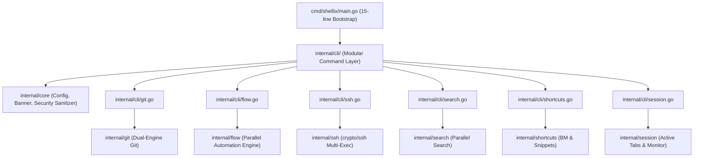

# Shellix System Architecture

This document describes the high-level and internal architecture of **Shellix (`sx`)**.

---

## 1. Architectural Philosophy

Shellix is built around three core pillars:
1. **Zero-Overhead Local Execution**: Eliminate OS process creation penalties on platforms like Windows by executing common tasks in-process (via pure Go libraries).
2. **Single Static Binary**: No CGO, no Node.js runtime, no dynamic DLL dependencies. Cross-compiled with `CGO_ENABLED=0`.
3. **Composability**: Modular internal packages (`internal/core`, `internal/git`, `internal/flow`, `internal/search`, `internal/terminal`) allowing clean extension and testing.

---

## 2. Component Diagram

---

## 3. Key Subsystems

### 3.1 Dual-Engine Git (`internal/git`)
- **Fast Path**: Reads Git object graphs directly from disk into memory using `go-git/v5`. Status queries execute in ~1.5–2.5ms without fork overhead.
- **Full Path**: For non-read operations or complex porcelain (e.g. interactive rebase, 3-way merge conflict resolution), Shellix transparently forwards arguments directly to the native `git` executable.

### 3.2 Automation Flow Engine (`internal/flow`)
- Parses declarative YAML workflows with cycle detection (Kahn's algorithm).
- Sorts steps topologically based on `depends_on: []` prerequisites and groups steps into chronological concurrent execution waves (`ComputeExecutionWaves`).
- Evaluates conditional gating (`if: ""`) and dynamic variable/parameter interpolation (`{{project_root}}`, `{{git.branch}}`, `{{params.<key>}}`, `{{steps.<name>.output}}`).
- Manages step timeouts with context cancellation, retries with exponential backoff, and step failure policies (`abort`, `continue`, `retry`).
- Interactive approval gates (`prompt: "..."`) requiring manual terminal confirmation (`y/N`) or `--yes` bypass.
- Artifact preservation (`CollectArtifacts`): globs build outputs, writes `manifest.json`, and archives artifacts into `~/.shellix/artifacts/<flow>/<run-id>/`.
- Cross-platform desktop alerts (PowerShell `NotifyIcon` BalloonTip/Toast on Windows, `osascript` on macOS) and HTTP webhook delivery upon flow completion.
- Dry-run execution blueprints (`sx flow plan`) and live Mermaid flowchart generation (`sx flow plan --mermaid`).
- Generates comprehensive, secret-sanitized execution audit logs with `0600` permissions.

### 3.3 Remote SSH & Port Forwarding (`internal/ssh`)
- Pure Go SSH manager leveraging `golang.org/x/crypto/ssh`.
- Enforces strict known-hosts verification with MITM protection and TOFU.
- Parallel multi-node command execution streaming color-coded outputs.
- Encrypted local TCP port forwarding tunnels (`ParseTunnelSpec`, `StartTunnel`) for remote database and microservice access.

### 3.4 High-Throughput Folder & Code Search Engine (`internal/search`)
- Traverses hundreds of checked-out project folders in parallel using `runtime.NumCPU() * 2` worker goroutines.
- Purely local filesystem operation: zero network or external Git dependencies.
- Automatically ignores noise directories (`.git`, `node_modules`, `vendor`, `build`, `target`, `bin`, `dist`) and skips binary assets via null-byte inspection.
- Top-level directory rollup summary aggregation (`--by-dir`), calculating folder hit counts, unique file matches, and duration.
- Surrounding context line extraction (`-C`, `-A`, `-B`) with GNU grep-style dimming and match highlighting.
- Script-ready listing modes (`--dirs-only`, `--files-only`, `--count`) for fast shell piping.
- Multi-format audit report generation (`WriteReportToFile`) supporting Markdown task checklists (`.md`), hierarchical JSON (`.json`), and RFC 4180 CSV (`.csv`).

### 3.4 Terminal Engine (`internal/terminal`)
- Unix/macOS: Allocates pseudo-terminals via `creack/pty`, hooks terminal raw mode, and forwards window resize signals (`SIGWINCH`).
- Windows: Spawns interactive shells (PowerShell/cmd) cleanly connected to `os.Stdin`/`os.Stdout`.

### 3.5 Automation Workflow Engine & Flow TUI (`internal/flow`)
- Declarative YAML multi-step workflow engine with DAG dependency scheduling (`depends_on`), conditional execution (`if`), parallel batch wave partitioning, and step output interpolation (`{{steps.<name>.output}}`).
- Built-in full-screen interactive Bubble Tea dashboard (`sx flow run --tui` / `sx flow tui`) featuring real-time spinners, live log streaming viewports, and progress badges.
- Secret-redacted audit logs written to `~/.shellix/logs/flows/` with strict `0600` permissions.

### 3.6 Command History & Execution Analytics (`internal/history`)
- In-memory, persistent command history store (`~/.shellix/history.json`) with strict `0700`/`0600` permission enforcement.
- Consecutive execution deduplication with frequency counters, timestamps, exit codes, and latency tracking.
- Fast in-memory filtering (`sx history search <query>`) and execution statistics dashboard (`sx history stats`) calculating success rates and top executed commands.
- Automatic pattern-based secret sanitization (GitHub tokens, Bearer tokens, AWS keys, passwords) preventing credential leakage to disk.

### 3.7 Native GitHub Suite (`internal/github`)
- Zero-external-dependency HTTPS client utilizing Personal Access Tokens (PAT) retrieved from native OS Keyring.
- Full support for Pull Requests (`sx pr list`, `view`, `checkout`), CI checks (`sx ci status`), and Issues (`sx issue list`, `view`, `create`, `close`).
- First-class support for public `github.com`, GitHub Enterprise Cloud (`*.ghe.com`), and on-premise GitHub Enterprise Server (`/api/v3`) with dynamic remote host auto-detection.
- Full-screen interactive GitHub TUI Dashboard (`sx gh` / `sx github`) with multi-tab PRs, Issues, and CI inspection.

### 3.8 Universal Command Palette (`internal/palette`)
- Unified fuzzy launcher aggregating all workflows, SSH profiles, bookmarks, snippets, history runs, and workbench superpowers.
- Keyboard-driven interactive selection with category badges and instant execution.

### 3.9 Interactive Git Branch & Stash Manager (`internal/git`)
- Sub-5ms branch listing, ahead/behind upstream commit tracking, and interactive fuzzy branch switcher (`sx branch`).
- Git stash management (`sx stash list`, `push`, `pop`).

### 3.10 Automated Flow File Watcher (`internal/flow`)
- Recursive workspace file monitoring with debouncing (`RunWatcher`) and extension filtering.
- Automatically clears screen and re-runs test/build pipelines upon filesystem changes with zero external runtime dependencies.

### 3.11 HTTP & API Terminal Client & Diffing Engine (`internal/httpclient`)
- High-precision network tracing via standard library `httptrace.ClientTrace`, measuring DNS lookup, TCP connection, TLS handshake, TTFB, and transfer duration down to microsecond resolution without external cURL binaries.
- Automatic body format detection (JSON, XML, HTML, plaintext) with terminal color syntax highlighting.
- High-concurrency endpoint comparison (`CompareEndpoints`) and recursive JSON structural diffing (`DiffJSON`), computing added/removed keys, value mismatches, and latency deltas.

### 3.12 Project Environment & Secret Injection (`internal/envvault`)
- Local hardware-authenticated secret management storing encrypted variables in workspace `.env.vault` files.
- AES-256-GCM authenticated encryption with 12-byte cryptographically secure random nonces and tamper-evident authentication tags.
- Automatic master key generation and persistence in native OS Credential Vault (Windows Credential Manager / macOS Keychain) keyed by workspace directory hash.
- Zero-leak child process injection (`RunWithEnv`), spawning subprocesses with injected environment variables without writing secrets to shell history, disk logs, or parent environment.

### 3.13 Flow Cron & Recurring Scheduler (`internal/flow`)
- Pure Go cron expression parser supporting standard 5-part cron syntax (`minute hour dom month dow`), step increments (`*/15`), ranges (`1-5`), lists (`1,15,30`), and macro aliases (`@hourly`, `@daily`, `@weekly`, `@monthly`, `@yearly`).
- Persistent job scheduler backed by `~/.shellix/schedules.json` (`0600`), tracking `LastRun`, `NextRun`, `RunCount`, and outcome status (`SUCCESS` / `FAILED`).
- Non-blocking daemon runner (`RunDaemon`) with polling loops and graceful OS interrupt signals (`SIGINT`/`SIGTERM`).

### 3.14 Streaming Large File & JSON Diff Engine (`internal/jsonview`)
- High-throughput streaming large file viewer (`StreamLargeFile`) operating on constant $O(\text{chunk size})$ memory footprint.
- Chunked reverse-seek algorithm for `--tail`, seeking 64KB blocks backwards from end of file to immediately display the last $N$ lines of multi-gigabyte log files without reading from start.
- JSONPath query evaluator (`EvaluateJSONPath`) supporting dot notation, array indexing (`items[0]`), and slice wildcards (`users[*].id`).
- Deep JSON schema structural diff engine (`CompareJSONFiles`) computing schema similarity percentage, added keys, removed keys, and value changes.
- Interactive Bubble Tea collapsible tree explorer (`JSONTUIModel`) allowing keyboard-driven node unfolding, search filtering, and path inspection.

### 3.15 Windows First-Class Priority Architecture & Background Services
- **Native Windows Credential Manager (`wincred`)**: Direct Win32 API interop for hardware-backed master key storage without external daemon dependencies.
- **Windows Task Scheduler Integration (`schtasks.exe`)**: First-class background scheduler service runner (`sx flow schedule daemon install`) that registers logon-triggered background executions without third-party service wrappers.
- **PowerShell Prompt Hooks & Auto-Completion**: Dynamic completion scripts and location-aware environment injection hooks (`sx env hook powershell`) integrated into PowerShell `$PROFILE`.

### 3.16 Zero-Latency Embedded Web Workbench (`internal/web`)
- **Pure Go Single Binary Web Server**: Built with `net/http` and `//go:embed` asset embedding, booting in $< 3\text{ ms}$ with zero Node.js, npm, or Docker dependencies.
- **Linear/Vercel Dark Design System**: High-density developer UI featuring Tokyo Night syntax highlighting, glassmorphism card surfaces, and subtle zinc borders.
- **Pre-Flight Code Review & Split Diffs**: Side-by-side and unified diff visualization (`ParseUnifiedDiff`) aligned by line numbers with additions/deletions stats and file tree filtering.
- **Modular Data Grid & Caching Architecture**: In-memory virtual data grid designed for viewing large datasets, with client-side caching, column sorting, instant filtering, and pagination.
- **Cross-Platform Browser Launcher**: Native browser spawn via `cmd.exe /c start` on Windows, `open` on macOS, and `xdg-open` on Linux.
