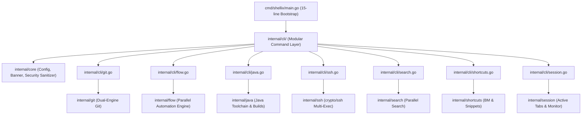

# Shellix System Architecture

This document describes the high-level and internal architecture of **Shellix (`sx`)**.

---

## 1. Architectural Philosophy

Shellix is built around three core pillars:
1. **Zero-Overhead Local Execution**: Eliminate OS process creation penalties on platforms like Windows by executing common tasks in-process (via pure Go libraries).
2. **Single Static Binary**: No CGO, no Node.js runtime, no dynamic DLL dependencies. Cross-compiled with `CGO_ENABLED=0`.
3. **Composability**: Modular internal packages (`internal/core`, `internal/git`, `internal/flow`, `internal/search`, `internal/terminal`) allowing clean extension and testing.

---

## 2. Component Diagram

---

## 3. Key Subsystems

### 3.1 Dual-Engine Git (`internal/git`)
- **Fast Path**: Reads Git object graphs directly from disk into memory using `go-git/v5`. Status queries execute in ~1.5–2.5ms without fork overhead.
- **Full Path**: For non-read operations or complex porcelain (e.g. interactive rebase, 3-way merge conflict resolution), Shellix transparently forwards arguments directly to the native `git` executable.

### 3.2 Automation Flow Engine (`internal/flow`)
- Parses declarative YAML workflows with cycle detection (Kahn's algorithm).
- Sorts steps topologically based on `depends_on: []` prerequisites.
- Evaluates conditional gating (`if: ""`) and variable interpolation (`{{project_root}}`, `{{git.branch}}`, `{{steps.<name>.output}}`).
- Manages timeouts, retries, step failure policies (`abort`, `continue`, `retry`), and sequential/parallel execution.
- Generates comprehensive, secret-sanitized execution audit logs with `0600` permissions.

### 3.3 Remote SSH & Port Forwarding (`internal/ssh`)
- Pure Go SSH manager leveraging `golang.org/x/crypto/ssh`.
- Enforces strict known-hosts verification with MITM protection and TOFU.
- Parallel multi-node command execution streaming color-coded outputs.
- Encrypted local TCP port forwarding tunnels (`ParseTunnelSpec`, `StartTunnel`) for remote database and microservice access.

### 3.4 Multi-Repo Search Engine (`internal/search`)
- Traverses registered repository trees in parallel using `runtime.NumCPU()` goroutines.
- Automatically ignores `.git`, `node_modules`, `vendor`, and binary files.
- Provides regex and literal matching with syntax-highlighted matching lines.

### 3.4 Terminal Engine (`internal/terminal`)
- Unix/macOS: Allocates pseudo-terminals via `creack/pty`, hooks terminal raw mode, and forwards window resize signals (`SIGWINCH`).
- Windows: Spawns interactive shells (PowerShell/cmd) cleanly connected to `os.Stdin`/`os.Stdout`.

### 3.5 Automation Workflow Engine & Flow TUI (`internal/flow`)
- Declarative YAML multi-step workflow engine with DAG dependency scheduling (`depends_on`), conditional execution (`if`), parallel batch wave partitioning, and step output interpolation (`{{steps.<name>.output}}`).
- Built-in full-screen interactive Bubble Tea dashboard (`sx flow run --tui` / `sx flow tui`) featuring real-time spinners, live log streaming viewports, and progress badges.
- Secret-redacted audit logs written to `~/.shellix/logs/flows/` with strict `0600` permissions.

### 3.6 Command History & Execution Analytics (`internal/history`)
- In-memory, persistent command history store (`~/.shellix/history.json`) with strict `0700`/`0600` permission enforcement.
- Consecutive execution deduplication with frequency counters, timestamps, exit codes, and latency tracking.
- Fast in-memory filtering (`sx history search <query>`) and execution statistics dashboard (`sx history stats`) calculating success rates and top executed commands.
- Automatic pattern-based secret sanitization (GitHub tokens, Bearer tokens, AWS keys, passwords) preventing credential leakage to disk.

### 3.7 Native GitHub Suite (`internal/github`)
- Zero-external-dependency HTTPS client utilizing Personal Access Tokens (PAT) retrieved from native OS Keyring.
- Full support for Pull Requests (`sx pr list`, `view`, `checkout`), CI checks (`sx ci status`), and Issues (`sx issue list`, `view`, `create`, `close`).
