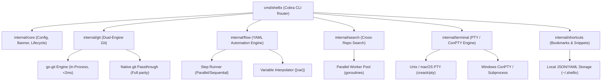

# Shellix System Architecture

This document describes the high-level and internal architecture of **Shellix (`sx`)**.

---

## 1. Architectural Philosophy

Shellix is built around three core pillars:
1. **Zero-Overhead Local Execution**: Eliminate OS process creation penalties on platforms like Windows by executing common tasks in-process (via pure Go libraries).
2. **Single Static Binary**: No CGO, no Node.js runtime, no dynamic DLL dependencies. Cross-compiled with `CGO_ENABLED=0`.
3. **Composability**: Modular internal packages (`internal/core`, `internal/git`, `internal/flow`, `internal/search`, `internal/terminal`) allowing clean extension and testing.

---

## 2. Component Diagram

---

## 3. Key Subsystems

### 3.1 Dual-Engine Git (`internal/git`)
- **Fast Path**: Reads Git object graphs directly from disk into memory using `go-git/v5`. Status queries execute in ~1.5–2.5ms without fork overhead.
- **Full Path**: For non-read operations or complex porcelain (e.g. interactive rebase, 3-way merge conflict resolution), Shellix transparently forwards arguments directly to the native `git` executable.

### 3.2 Automation Flow Engine (`internal/flow`)
- Parses declarative YAML workflows.
- Evaluates environmental and project context variables (`{{project_root}}`, `{{git.branch}}`, `{{env.NAME}}`).
- Manages timeouts, retries, step failure policies (`abort`, `continue`, `retry`), and sequential/parallel execution.

### 3.3 Multi-Repo Search Engine (`internal/search`)
- Traverses registered repository trees in parallel using `runtime.NumCPU()` goroutines.
- Automatically ignores `.git`, `node_modules`, `vendor`, and binary files.
- Provides regex and literal matching with syntax-highlighted matching lines.

### 3.4 Terminal Engine (`internal/terminal`)
- Unix/macOS: Allocates pseudo-terminals via `creack/pty`, hooks terminal raw mode, and forwards window resize signals (`SIGWINCH`).
- Windows: Spawns interactive shells (PowerShell/cmd) cleanly connected to `os.Stdin`/`os.Stdout`.
