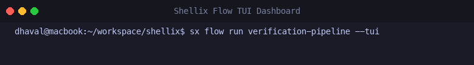

# Shellix Flows Automation Engine

**Shellix Flows** are declarative, YAML-based pipelines designed to automate multi-step developer routines, local builds, tests, deploys, and maintenance scripts without writing complex Bash or PowerShell scripts.

---

## 1. Flow File Structure

Flow files are stored in `.yaml` or `.yml` files, typically placed in:
- Project root: `./shellix-flow.yaml` or `./.shellix/flows/*.yaml`
- User home: `~/.shellix/flows/*.yaml`

```yaml
name: build-and-test
description: Run code formatting, unit tests, and cross-platform build
env:
  CGO_ENABLED: "0"

steps:
  - name: lint-and-vet
    run: go vet ./...
    timeout: 1m
    on_failure: abort

  - name: test-suite
    run: go test -race -v ./...
    timeout: 5m
    on_failure: abort

  - name: compile
    run: make build
    timeout: 2m
```

---

## 2. Step Configuration Reference

| Field | Type | Default | Description |
|---|---|---|---|
| `name` | string | `step-N` | Human-readable name for the step |
| `run` | string | **required** | Command string executed in shell |
| `working_dir` | string | `.` | Execution directory (supports interpolation) |
| `timeout` | string | none | Maximum execution duration (e.g. `30s`, `5m`) |
| `on_failure` | string | `abort` | Failure strategy: `abort` or `continue` |
| `retries` | int | `0` | Number of times to retry upon non-zero exit |
| `retry_delay` | string | `1s` | Delay between retry attempts (e.g. `2s`, `5s`) |
| `parallel` | bool | `false` | When true, adjacent parallel steps run concurrently |
| `env` | map | none | Key-value pairs injected into step environment |

---

## 3. Parallel Step Execution

Adjacent steps marked with `parallel: true` are batched and executed concurrently using Go goroutines:

```yaml
name: parallel-ci-pipeline
steps:
  - name: prep-step
    run: echo "Initializing environment..."

  # The following two steps run concurrently in parallel:
  - name: compile-backend-java
    run: sx j build
    parallel: true

  - name: compile-frontend
    run: npm run build
    parallel: true

  # Resumes sequential execution once all parallel tasks finish:
  - name: run-integration-tests
    run: go test ./...
```

---

## 4. Comprehensive Audit Logging

Every execution automatically generates a timestamped audit log in:
```
~/.shellix/logs/flows/<flow-name>-YYYYMMDD-HHMMSS.log
```

The log records:
- Flow name, Run ID, host architecture, and execution timestamp
- Per-step start time, duration, status, and complete raw stdout/stderr
- Execution mode (Sequential vs Parallel worker)
- Final overall outcome and elapsed time

### Inspecting Logs via CLI

```bash
# List recent execution logs
sx flow logs

# View details of a specific log file
sx flow logs <filename.log>
```

---

## 3. Dynamic Variable Interpolation

Shellix dynamically resolves runtime context within your `run` commands and `working_dir`:

| Variable | Description |
|---|---|
| `{{project_root}}` | Root directory of the repository/workspace |
| `{{git.branch}}` | Active Git branch name |
| `{{timestamp}}` | Current UTC timestamp (RFC3339) |
| `{{date}}` | Current date formatted as `YYYY-MM-DD` |
| `{{env.VARIABLE_NAME}}` | System environment variable |

### Example:

```yaml
name: package-release
steps:
  - name: build-archive
    run: tar -czf dist/app-{{git.branch}}-{{date}}.tar.gz -C bin/ .
```

---

## 4. Running Flows with CLI & Interactive TUI

```bash
# Execute a specific flow file
sx flow run ./deploy.yaml

# Execute with full-screen interactive Bubble Tea TUI
sx flow run verification-pipeline --tui
# Or shortcut command
sx flow tui verification-pipeline

# Validate syntax without executing
sx flow validate ./deploy.yaml

# List user and fixture flows
sx flow list
```

### Interactive Flow TUI (`sx flow run --tui`)

Shellix features a full-screen, split-pane Bubble Tea dashboard for workflow executions:
- **Left Panel (Steps Execution)**: Displays step status badges (`⏳` Pending, `🔄` Running spinner, `✔` Success, `⏭` Skipped, `✖` Failed), execution duration per step, and `⚡` parallel badges.
- **Right Panel (Live Logs Viewport)**: Live scrollable output of the currently selected step.
- **Interactive Navigation**: Navigate between steps with `↑`/`↓` or `j`/`k`, scroll logs with `pgup`/`pgdn`, quit with `q`/`esc`.


